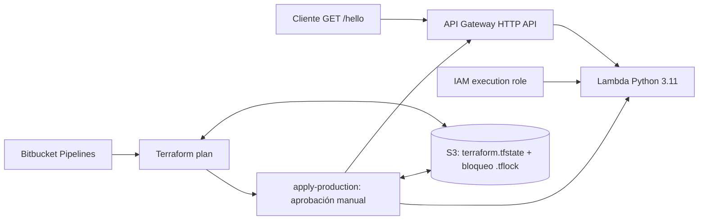

# Laboratorio 10.1 · Terraform y Bitbucket Pipelines

Implementación basada en la [guía del curso UTEC](https://github.com/utec-devops-2026/laboratorios/blob/main/laboratorio_IaC/laboratorio_terraform_bitbucket.md).

**Estado:** código y validaciones locales aprobados; despliegue real AWS ejecutado con Terraform (8 recursos). [API verificada con HTTP 200](https://4ldgqb66wc.execute-api.us-east-1.amazonaws.com/hello?name=UTEC). El pipeline Bitbucket y las capturas se están completando. Este GitHub es la copia de entrega solicitada.

## Archivos

```text
app/handler.py             Lambda en Python estándar
main.tf                    IAM, Lambda, API Gateway v2 y backend S3
variables.tf               Región y nombre del proyecto
backend.hcl                Bucket, ruta de estado y bloqueo S3 nativo
bitbucket-pipelines.yml    Validación paralela → plan → apply manual
.terraform.lock.hcl        Versiones y checksums de providers para macOS/Linux
tests/test_handler.py      Contrato de respuesta del handler
evidencias/                Resultados reales y lista de entregables
```

## Arquitectura



El archivo ZIP se genera con `archive_file`. `source_code_hash` hace que un cambio de código se refleje en el próximo plan. Lambda espera a que se adjunten sus permisos de logs antes de crearse. La salida `api_url` usa `api_endpoint` para evitar un doble `/`.

## Validación local sin AWS

Requisitos: Python 3.11+ y Terraform 1.11+. La validación registrada se ejecutó con Terraform 1.16.5. El pipeline sigue la imagen Terraform 1.11 de la guía.

```bash
python3 app/handler.py
python3 -m unittest discover -s tests -v
terraform init -backend=false -input=false
terraform fmt -check -recursive -diff
terraform validate
python3 -m venv .venv
.venv/bin/pip install flake8==7.3.0 PyYAML==6.0.3
.venv/bin/flake8 app/ tests/ --max-line-length=100 --statistics
.venv/bin/python -c "import yaml; yaml.safe_load(open('bitbucket-pipelines.yml')); print('YAML OK')"
```

Los resultados están en [evidencias/local](evidencias/local). Son validaciones locales: no acreditan que el pipeline o la API AWS hayan corrido.

## Completar Bitbucket y AWS

1. Crear o seleccionar el repositorio Bitbucket `bitbucket_terraform_demo`, subir esta misma estructura a `main` y habilitar Pipelines. Registrar su URL y el usuario docente en [el índice de evidencias](evidencias/README.md).
2. Confirmar el usuario Bitbucket y adaptar el nombre del bucket en `backend.hcl`. El bucket `tf-state-aarontimana04-utec` ya está creado, con versionado y acceso público bloqueado; el estado remoto fue verificado.
3. Con una identidad AWS autorizada, crear el bucket en `us-east-1`, habilitar versionado y bloquear acceso público:

   ```bash
   aws s3api create-bucket --bucket tf-state-aarontimana04-utec --region us-east-1
   aws s3api put-bucket-versioning --bucket tf-state-aarontimana04-utec --versioning-configuration Status=Enabled
   aws s3api put-public-access-block --bucket tf-state-aarontimana04-utec --public-access-block-configuration BlockPublicAcls=true,IgnorePublicAcls=true,BlockPublicPolicy=true,RestrictPublicBuckets=true
   terraform init -reconfigure -backend-config=backend.hcl
   terraform plan
   ```

4. Configurar `AWS_ACCESS_KEY_ID` y `AWS_SECRET_ACCESS_KEY` como **Repository variables Secured** en Bitbucket; `AWS_DEFAULT_REGION=us-east-1` sin Secured. Si las credenciales son temporales, añadir también `AWS_SESSION_TOKEN` como Secured y renovarlas antes de que expiren. El step `plan` necesita estas variables, por eso no basta con configurarlas solo en Deployment variables. No escribirlas en Git ni en capturas.
5. Revisar `tfplan.txt` y aprobar **Deploy** en `apply-production`. El apply aplica el mismo `tfplan` generado previamente y recibe `lambda.zip` como artifact. El smoke test guarda `hello-aws.json` y verifica `Hello, UTEC!`.
6. Capturar el pipeline exitoso, el objeto S3 `tf-lambda-demo/terraform.tfstate`, Lambda y la respuesta HTTP real. Agregar las capturas a `evidencias/` y enlazarlas en el índice.
7. Dar acceso de lectura al usuario Bitbucket del docente indicado en clase.

El backend requiere permisos sobre el bucket y sus objetos, incluido `s3:DeleteObject` para liberar `.tflock`. El despliegue necesita permisos para los recursos Lambda, IAM y API Gateway de este laboratorio. El estado, planes binarios, ZIP y credenciales están excluidos del repositorio.

## Flujo CI/CD

- Pull request: `fmt-check`, `validate` y `lint-python` en paralelo; este último también ejecuta cuatro pruebas del handler. No se ejecutan plan ni apply en PR.
- Push a `main`: las mismas validaciones → `plan` → stage manual `apply-production` con deployment `production`.
- Artifacts del plan: `tfplan`, `tfplan.txt`, `lambda.zip`; artifact del apply: `hello-aws.json`.
- Pipeline custom `destroy`: elimina los recursos administrados por Terraform. No se ejecuta automáticamente ni elimina el bucket de estado.

## Comparaciones del laboratorio

| Aspecto | Terraform | Serverless Framework |
|---|---|---|
| Infraestructura | Recursos explícitos en HCL | Abstracción en `serverless.yml` |
| IAM y API HTTP | Se declaran role, permisos e integración | El framework genera recursos de CloudFormation |
| Paquete Lambda | `archive_file` + hash | Empaquetado del framework |
| Estado | Backend elegido; aquí S3 | Stack CloudFormation en AWS |
| Eliminación | `terraform destroy` | `serverless remove` |

| Aspecto | GitLab CI | Bitbucket Pipelines |
|---|---|---|
| Unidad y orden | Jobs; stages y needs | Steps; orden de lista y parallel |
| Aprobación | `when: manual` | `trigger: manual` en stage |
| Estado Terraform | Puede usar backend HTTP de GitLab | En este lab usa S3 externo |
| Credenciales | Variables CI/CD | Repository variables / Deployment variables |

El backend es independiente del proveedor de CI: GitLab también podría usar S3. El bucket se crea primero porque `terraform init` necesita un backend que ya exista. `use_lockfile=true` utiliza un objeto S3 para el bloqueo, sin DynamoDB.

## Limpieza al finalizar

Después de guardar las evidencias y decidir que ya no se necesita la API, ejecutar el pipeline manual `custom: destroy`, o:

```bash
terraform init -reconfigure -backend-config=backend.hcl
terraform destroy
```

El bucket conserva el estado y sus versiones; su eliminación se gestiona aparte. El despliegue inicial fue realizado desde la CLI local; el log real está en `evidencias/aws/terraform-apply.txt`. Los recursos siguen activos para completar las capturas y el pipeline. No se ha ejecutado destroy.
